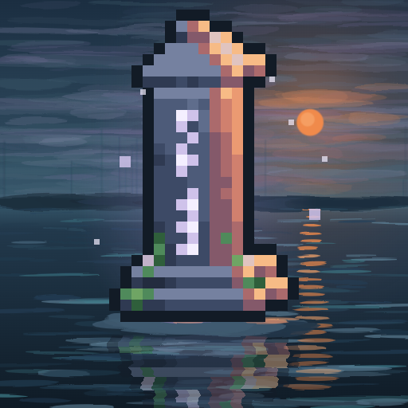
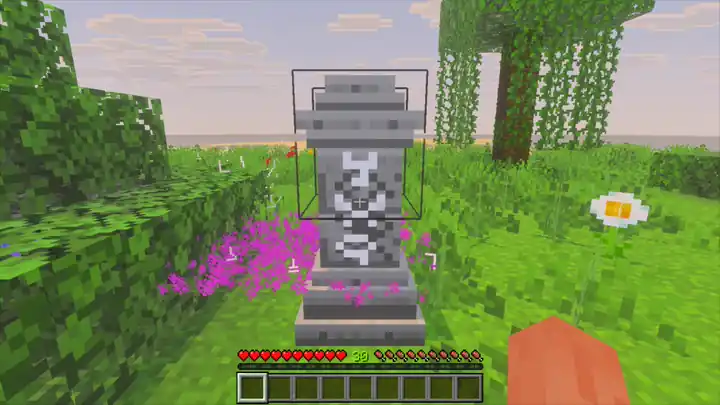
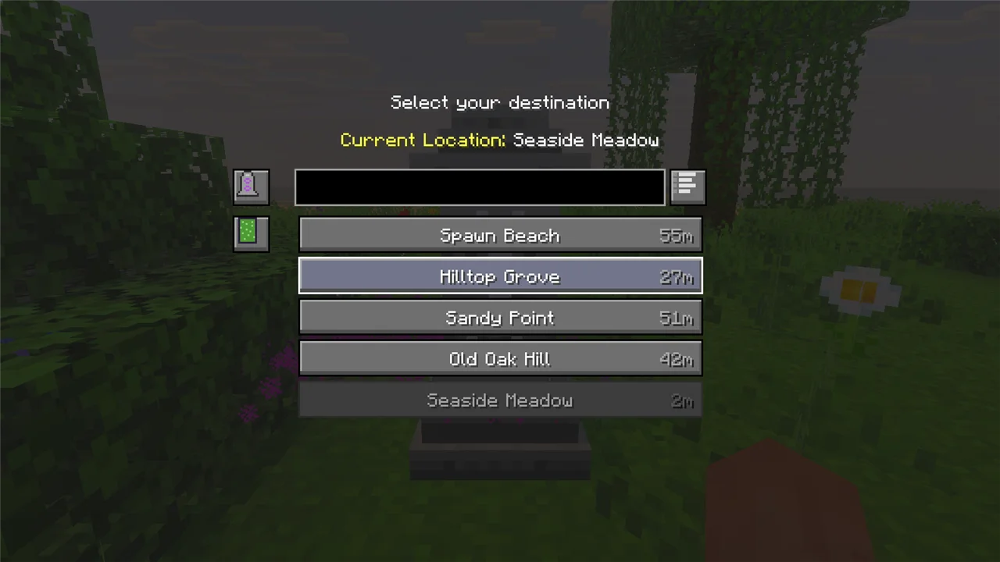
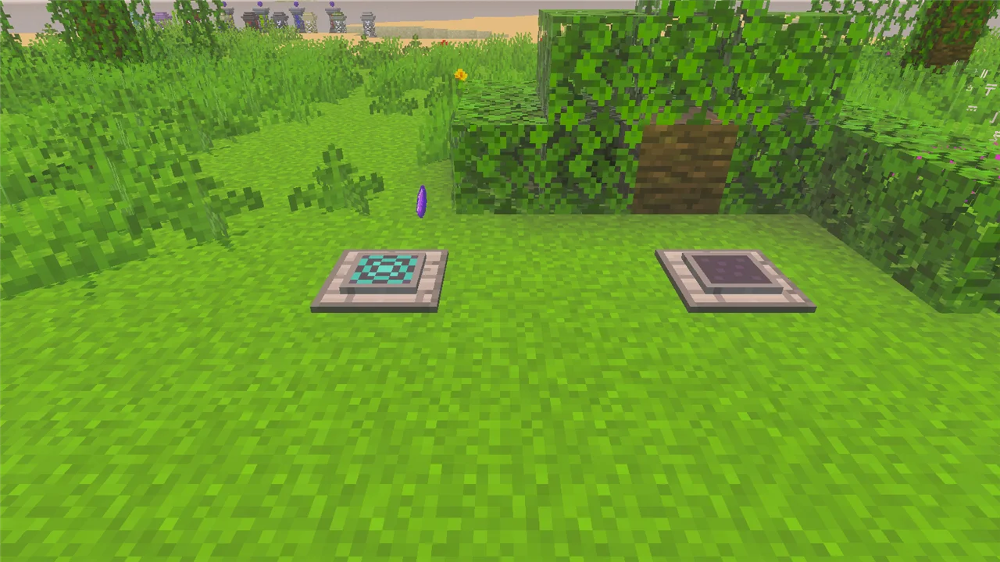

# Bedstones



[](https://github.com/LiteLDev/Bedstones/releases/latest)
[](COPYING.LESSER)

Waystones for Minecraft Bedrock. Build a waystone wherever you like to come back to, visit it once, and from then on warp to it from any other waystone, scroll or warp stone. Bedstones brings BlayTheNinth's Java mod [Waystones](https://www.curseforge.com/minecraft/mc-mods/waystones) to Bedrock, for dedicated servers and single-player worlds.



## Features

- **Waystones in 10 styles.** Name it when you place it. Each one you visit lights up its runes and joins your list.
- **The Waystones menu.** Every waystone you have found, with search, sorting, favourites, groups, the distance and the XP cost of each trip.
- **Sharestones.** Every sharestone of one colour links to all the others, for the whole server, with nothing to activate.
- **Warp plates.** Step on one and you are carried to the plate its shard is attuned to.
- **Scrolls and the warp stone.** Warp from anywhere: a reusable warp stone, one-shot warp scrolls, return scrolls, and bound scrolls that go straight to one waystone.
- **Wild and village waystones** to find while exploring.



## Install

You need Minecraft Bedrock **1.26.51** for Windows (x64) with LeviLamina **26.51.x** (on a client, installed through [LeviLauncher](https://github.com/LiteLDev/LeviLauncher)).

With [lip](https://github.com/futrime/lip):

```sh
lip install github.com/LiteLDev/Bedstones           # dedicated server
lip install github.com/LiteLDev/Bedstones#client    # client
```

Or download the zip from the [latest release](https://github.com/LiteLDev/Bedstones/releases/latest) and extract it next to `LeviLamina/`:

| Where | Zip | Folder |
| --- | --- | --- |
| Dedicated server | `bedstones-server-windows-x64.zip` | `plugins/Bedstones/` |
| Client (LeviLauncher) | `bedstones-client-windows-x64.zip` | `mods/Bedstones/` |

- **On a server**, only the server needs Bedstones. Players download its textures when they join, and anyone can play, with or without the client mod. Players without it get the same menus as simple forms.
- **The client mod** plays single-player worlds by itself. On a server that runs Bedstones, it draws the real Waystones screens instead of forms.

## How to use

1. Craft a **warp stone** (amethyst shards, ender pearls, an emerald), then a **waystone** (stone bricks around the warp stone, on a row of obsidian).
2. Place the waystone and give it a name. It is now yours and activated.
3. Right-click any other waystone (another player's, or a wild or village one) to **activate** it.
4. Right-click an activated waystone, or use a warp stone or warp scroll, to open the menu and **warp**.

Warping costs a few XP points, more for longer trips, 27 at most (also for changing dimension). Scrolls, warp plates and global waystones are free. Shift + right-click a waystone to rename it, set who can see it (activation, team or global) or open its warp modifiers.



| Block | What it does |
| --- | --- |
| Waystone (10 styles) | A destination. Activate it once, then warp to it from anywhere. |
| Sharestone (15 colours) | Linked to every sharestone of its colour. No activation needed. |
| Portstone (16 colours) | Opens the menu but is not a destination. White lists your waystones, a colour lists that colour's sharestones. |
| Warp Plate | Put a dormant shard in it to attune the shard here. A plate holding that shard sends whatever steps on it back here. A deepslate shard locks a plate. |
| Warp Portal | Opened by a portal scroll. It carries everyone through to one destination for 5 minutes. |
| Fleeting Memorial | Left where you die while carrying an Epitaph. You can warp back to it once. |

| Item | What it does |
| --- | --- |
| Warp Stone | Hold use to open the menu. 128 uses. |
| Warp Scroll | The same, used up on use. |
| Return Scroll | Back to your last warp portal, or to the nearest activated waystone. |
| Blank / Bound Scroll | Use a blank scroll on a waystone to bind it: the bound scroll warps straight there. |
| Portal Scroll | Opens a warp portal to the destination you pick. |
| Twinbound Feather | Link two feathers, and each owner can warp to the other. |
| Epitaph | Leaves a fleeting memorial where you die. |

Waystones and warp plates hold up to 4 **warp modifiers** that affect whoever arrives: blaze powder sets them on fire, a feather gives slow falling, a redstone torch turns a plate off while powered, and more.

### Commands

`/waystones` (or `/bedstones`). Everything except `inventorybutton` and `companion` is for operators.

| Command | What it does |
| --- | --- |
| `activate <players> <pos>` / `forget <players> <pos>\|all` | Activate or forget waystones for players |
| `place <pos> <style> <name>` | Place a named waystone |
| `count <player>` / `list <player> [all]` | Show a player's waystones |
| `gui <player>` | Open a player's menu as an admin |
| `twinbound <first> <second>` | Link two players' Twinbound Feathers |
| `cooldown <players> reset all\|reset <id>\|add <id> <seconds>\|set <id> <seconds>` | Manage warp cooldowns |
| `reload` | Reload the settings and translations |
| `inventorybutton` | Use the inventory button (for players without the client mod) |
| `companion` | Show who runs the client mod |

## Settings

The settings are JSON files in the mod's `config/` folder (`plugins/Bedstones/config/` on a server, `mods/Bedstones/config/` on a client), with Waystones' option names. Run `/waystones reload` after editing.

| File | What you can change |
| --- | --- |
| `general.json` | Who may place and manage waystones (`restrictedWaystones`, `allowEveryoneToManageGlobalWaystones`), the default visibility, generated names |
| `requirements.json` | XP costs and cooldowns on or off (`enableCosts`, `enableCooldowns`), and the rules themselves (`warpRequirements`) |
| `teleports.json` | Take pets and leashed animals along, mobs that may not warp |
| `items.json` | How long warp stones and scrolls take to use, warp stone durability |
| `warpPlate.json` | Warp plate use time and cooldown |
| `modifiers.json` | Warp modifiers on or off |
| `inventoryButton.json` | The warp button in the inventory: off (default), `NEAREST`, `ANY` or a waystone name, and its position |
| `worldGen.json` | Wild waystones (style, how often, which dimensions) and village waystones |
| `client.json` | `disableTextGlow` (client mod) |
| `mod.json` | Language, use each player's language, require the resource pack |

## Differences from the Java mod

Bedrock has no equivalent for a few Java features, so Bedstones does the following instead:

- **Teams.** Bedrock has no scoreboard teams. A player's team is set by a `team:<name>` tag, for
  example `/tag @s add team:builders`. "Visible to Team" waystones and the Teams group use that tag.
- **Map mods and statistics.** JourneyMap, Dynmap, BlueMap and Jade/WTHIT have no Bedrock
  versions, and Bedrock has no custom statistics, so those integrations and the
  `waystones:waystone_activated` statistic are not provided.

## More

More screenshots and videos: https://levimc.org/mods/github.com/LiteLDev/Bedstones/?tab=gallery

Building it yourself or contributing? See [CONTRIBUTING.md](CONTRIBUTING.md). Bedstones speaks English and Simplified Chinese.

## License

[LGPL-3.0](COPYING.LESSER) © 2026 Zijian Zhang. Bedstones copies no code or assets from Waystones and is not affiliated with Mojang Studios, Microsoft, or BlayTheNinth.
